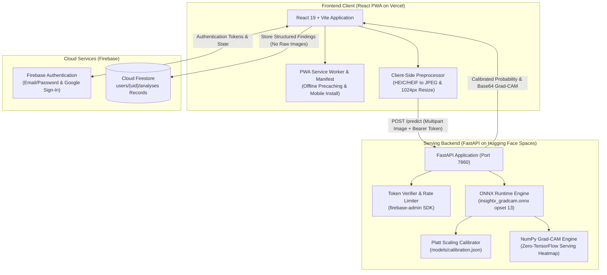

# 🩻 INSIGHT-X: AI-Powered Multimodal Clinical Decision Support System

[](https://github.com/your-username/insightx/actions/workflows/ci.yml)
[](https://insightx.web.app)
[](https://huggingface.co/spaces)
[](LICENSE)

> [!CAUTION]
> **Research Demo Only — Not a Certified Medical Device**  
> InsightX is an academic research demonstration and is not certified as a medical device by the FDA, CE, or any regulatory health authority. Model outputs represent algorithmic predictions and visual attention heatmaps for investigational and research purposes only, not clinical diagnoses. Model outputs must never be used to guide diagnostic decisions, patient management, or clinical interventions. Always consult a qualified radiologist or physician.

---

## 🎬 Product Demo

<!-- DEMO GIF PLACEHOLDER -->
```markdown

```
*(Demo GIF placeholder: Drag-and-drop radiograph upload, iPhone HEIC in-browser conversion, low-latency ONNX classification, and real-time Grad-CAM opacity adjustments)*

---

## 📌 Executive Summary

INSIGHT-X is an AI-powered clinical decision support system for automated chest radiograph finding classification.  
The core vision model fine-tunes a MobileNetV2 backbone on the Indiana University Chest X-Ray dataset using patient-level group splits.  
It deploys dual-head ONNX models for sub-100ms inference and zero-TensorFlow serving-time Grad-CAM explainability in pure NumPy.  
Platt probability scaling eliminates neural network overconfidence, reducing test calibration error tenfold.  
The client delivers a responsive React Progressive Web App with Firebase Authentication and Firestore clinical history logging.  

---

## 🏗️ System Architecture



---

## 📊 Empirical Evaluation & Metrics

All metrics reported below will be computed on the held-out patient-level test split ($N = 1,095$ images across $564$ unique patient UIDs) and written to `reports/metrics.json` and `reports/baselines.md` after real model training on local radiographs:

### Model Performance (Test Split)

| Metric | Score | Specification |
|---|---|---|
| **Accuracy** | PENDING: filled in after real training | Standard decision threshold ($0.50$) |
| **F1-Score** | PENDING: filled in after real training | Harmonic mean of precision & recall |
| **ROC-AUC** | PENDING: filled in after real training | Area Under Receiver Operating Characteristic Curve |
| **Sensitivity @ 90% Specificity** | PENDING: filled in after real training | Evaluated at threshold PENDING: filled in after real training |
| **Brier Score (Uncalibrated)** | PENDING: filled in after real training | Mean squared probability error (raw sigmoid output) |
| **Brier Score (Calibrated)** | PENDING: filled in after real training | Post-Platt scaling fitted on validation split |

### Confusion Matrix (Test Split)

| | Predicted Normal (`0`) | Predicted Abnormal (`1`) |
|---|---|---|
| **Actual Normal (`0`)** | PENDING: filled in after real training (TN) | PENDING: filled in after real training (FP) |
| **Actual Abnormal (`1`)** | PENDING: filled in after real training (FN) | PENDING: filled in after real training (TP) |

---

## 🔬 Modality Comparison: Text vs Image vs Fused

Test split baseline comparison as documented in `reports/baselines.md`:

| Modality / Baseline Model | Accuracy | F1-Score | ROC-AUC |
|---|---|---|---|
| **Text-Only (Findings TF-IDF, 1,000 features)** | PENDING: filled in after real training | PENDING: filled in after real training | PENDING: filled in after real training |
| **Image-Only (MobileNetV2 GAP Features)** | PENDING: filled in after real training | PENDING: filled in after real training | PENDING: filled in after real training |
| **Fused (Image + Text Concatenation)** | PENDING: filled in after real training | PENDING: filled in after real training | PENDING: filled in after real training |

### Why the Text Baseline Scores High
The Indiana University disease annotations (`Problems` / MeSH terms) were extracted directly from the written radiology reports by clinical catalogers. As a result, tokens in the `findings` narrative share direct lexical and semantic overlap with the assigned abnormality categories. Evaluating a text model against labels extracted from that exact narrative naturally yields high performance due to label circularity.

### Why the Production System is Image-Only
In actual hospital intake workflows, an official radiology report **does not exist at scan acquisition time**:
1. An automated pre-read decision support tool must analyze raw radiograph pixel data immediately after acquisition.
2. Requiring an authored radiologist report at inference time would render the AI redundant, as a human clinician would already have completed the diagnostic reading.
3. Therefore, InsightX serving is strictly **image-only**, taking chest radiographs as input to produce classifications and Grad-CAM attention overlays.

---

## ⚡ Run Locally in Three Commands

You can run both the FastAPI ONNX backend and the Vite React frontend locally using three commands:

```bash
# 1. Install Python and Web dependencies
pip install -r requirements.txt && npm --prefix web install

# 2. Launch the FastAPI ONNX serving API (starts on http://localhost:7860)
uvicorn api.main:app --host 0.0.0.0 --port 7860 --reload

# 3. Launch the React PWA frontend (starts on http://localhost:5173)
npm --prefix web run dev
```

---

## 🚀 Hugging Face Spaces Deployment (Docker SDK)

The API is containerized using `api/Dockerfile` with a minimal runtime environment (no TensorFlow dependency, pure ONNX Runtime on CPU) and exposes port `7860`:

```bash
# Build Docker image
docker build -f api/Dockerfile -t insightx-api .

# Run locally or in cloud container runtime
docker run -p 7860:7860 \
  -e FIREBASE_SERVICE_ACCOUNT_JSON='{"type":"service_account","project_id":"..."}' \
  -e ALLOWED_ORIGINS="*" \
  insightx-api
```

### Endpoints
- `GET /health`: Health status and active model version.
- `GET /samples`: List of available demo sample IDs.
- `GET /samples/{id}/predict`: Guest trial prediction without authentication (rate limited to 10 req/min per IP).
- `POST /predict`: Authenticated prediction for user-uploaded radiographs (`PNG`, `JPEG`, max 8 MB). Requires a valid Firebase Bearer token with a verified email address (rate limited to 10 req/min per UID).

---

## ⚠️ System Limitations & Failure Modes

1. **Single-Institution Cohort**: All training and testing cases originate from a single health system (Indiana University). The model has not been evaluated across multi-institutional datasets (e.g. CheXpert, MIMIC-CXR) and may experience domain shift under different radiography machines, exposure settings, or patient demographics.
2. **Label Noise from Report-Derived Annotations**: Ground truth labels were generated from automated NLP and MeSH cataloging of unstructured clinical reports rather than multi-reader panel adjudication or histopathological confirmation.
3. **Mixed Frontal and Lateral Views**: The collection mixes posteroanterior (PA), anteroposterior (AP), and lateral projections under a unified binary target without projection-specific conditioning.
4. **Subtle & Micro-Lesions**: Global Average Pooling across the $7 \times 7$ feature grid can dilute localized focal abnormalities (such as solitary pulmonary nodules $< 1$ cm or apical pneumothoraces).
5. **Medical Artifacts**: Foreign bodies, pacemakers, surgical clips, monitoring leads, and anatomical rotation may generate spurious Grad-CAM activations.
6. **No Sub-Pathology Discrimination**: The binary classification targets broad abnormality, without distinguishing between benign chronic changes (e.g., granulomas) and acute emergencies (e.g., tension pneumothorax).
7. **No Clinical Validation**: The system has not undergone prospective clinical trials, reader study validation, or safety audits. It must not be deployed for clinical care.

---

## 📄 License & Attribution

This project is open-source under the [MIT License](LICENSE).  
Chest radiograph data is sourced from the [Indiana University Chest X-ray Collection](https://openi.nlm.nih.gov/) (OpenI / NLM).
